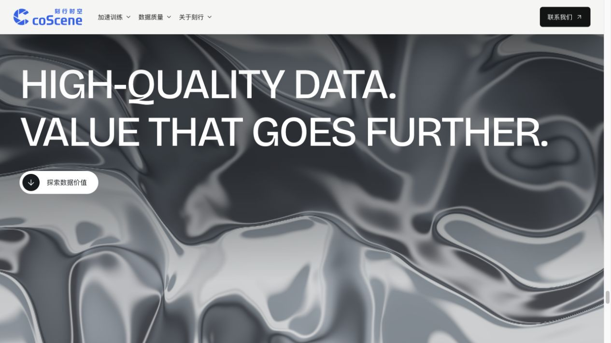

# 刻行时空官网升级计划

刻行时空官网定稿成果的公开代码仓：[`qikenegg/website-upgrade`](https://github.com/qikenegg/website-upgrade)。当前版本为 **v2.0.0 · 2026-10-10**，保留首页、加速训练、交付保障、关于刻行及配套阅读页。

## 版本区分

| 版本 | 日期 | 归档内容 |
| --- | --- | --- |
| [v1.0.0 · 第一版](https://github.com/qikenegg/website-upgrade/releases/tag/v1.0.0) | 2026-10-06 | 首次公开归档，5 个正式入口；首页、加速训练与交付保障，不含当时仍在开发的「关于刻行」独立页。对应首次发布提交 `4adc5b0`。 |
| [v2.0.0 · 第二版](https://github.com/qikenegg/website-upgrade/releases/tag/v2.0.0) | 2026-10-10 | 6 个正式入口；新增已定稿的「关于刻行」，更新首页粒子叙事、液态银色视觉与三张价值卡，并整合共享导航、合作表单及页脚。 |

`main` 保留最新版本；版本标签保留各次归档。完整变更见 [CHANGELOG.md](CHANGELOG.md)，范围和历史记录见 [docs/ARCHIVE.md](docs/ARCHIVE.md)。



[查看第二版合作表单截图](docs/evidence/v2/desktop-contact.png)。截图来自定稿合并时的本地预览。

## 本地运行

使用 Node.js 24 与 npm。在仓库根目录执行：

```bash
npm ci
npm run dev
```

打开 Vite 在终端输出的本地地址。检查与正式构建：

```bash
npm run lint
npm run build
npm run preview
```

`npm run build` 先从同一份内容 JSON 生成静态任务记录，再编译页面并复制运行所需素材至 `dist/`。正式页面使用站点根路径，预览时应通过本地服务器访问。

## 页面入口

| 路径 | 内容 |
| --- | --- |
| `/` | 官网首页 |
| `/training/robot-data/` | 加速训练：真机数据、第一人称公开样例与数据基础设施 |
| `/training/robot-data/sources/` | 模型与素材说明 |
| `/quality/delivery/` | 交付保障 |
| `/quality/delivery/records/` | 无需 JavaScript 的 15 份任务记录 |
| `/about/` | 关于刻行：经营理念、连接与协作、团队、联系与合作 |

首页「联系我们」指向本页 `#contact`；其他页面的通用咨询入口指向 `/about/#contact`。历史研究入口和未接入方案不作为本仓的页面发布。

## 代码与素材

- `src/`：已接入页面及其共享组件、交互和样式。部分文件保留原有 `study` 名称，仍是正式页面的运行依赖。
- `public/assets/`：当前页面实际使用的媒体、模型、字体及对应来源记录。
- `scripts/`：静态记录生成、运行素材复制和模型资产清单等构建工具。
- `docs/ARCHIVE.md`：归档范围与历史接入记录说明。
- `DESIGN.md`：本次保留的页面设计约定。
- `CHANGELOG.md`：各版差异和固定版本入口。

第三方模型、字体和公开样例的来源及使用边界见素材目录中的 `SOURCES.md`、`SOURCES.json`、`LICENSE.txt` 和相关说明文件，以及页面 `/training/robot-data/sources/`。构建同时生成 `dist/third-party-licenses.md`，记录打包软件依赖的许可。

## 预览与发布状态

公开仓库用于分享代码和归档成果，不代表正式域名已部署或线上官网已替换。首页与关于页的合作表单只做本地字段验证，提交后显示「当前为页面预览，信息尚未发送。」；没有发送、保存或外部收集接口。

关于页开场保留定稿时使用的远程 Wix 参考视频和海报，加载依赖外部地址，来源见 [关于页参考说明](docs/archive/about-reference.md)。首页机器人动作是程序编排，曲线标注为 Illustrative；它们不表示实测采集、物理仿真或训练收益。
